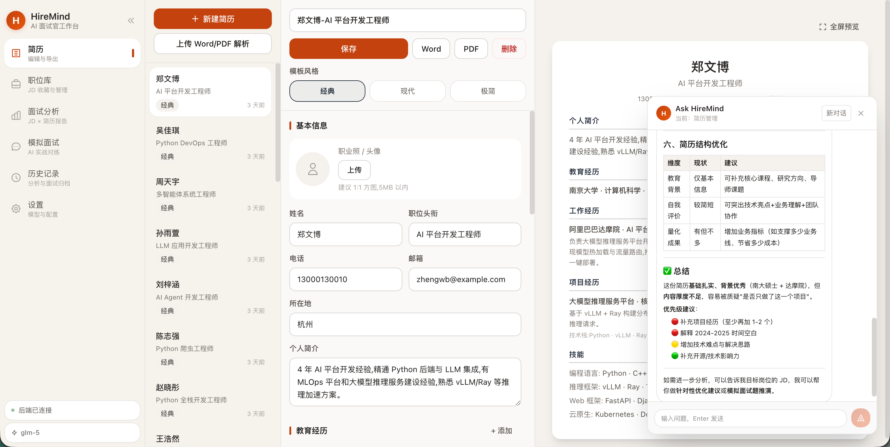
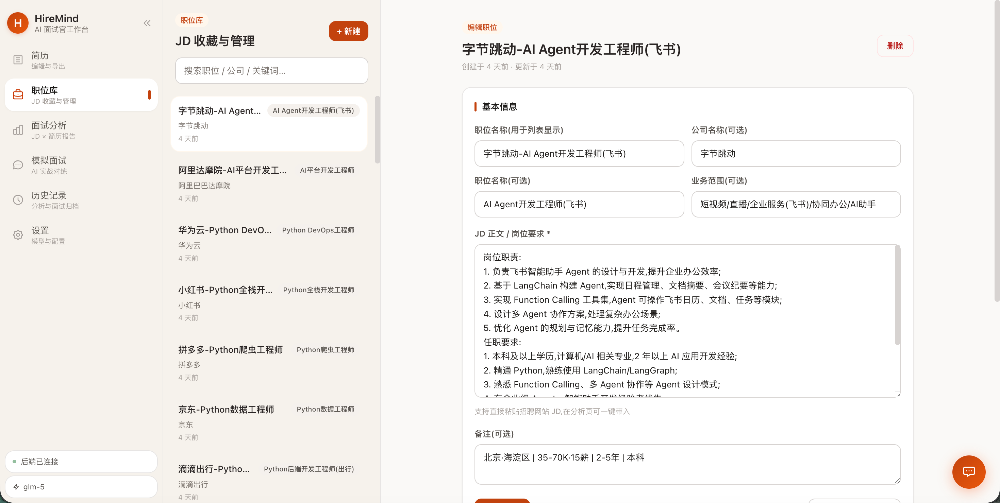
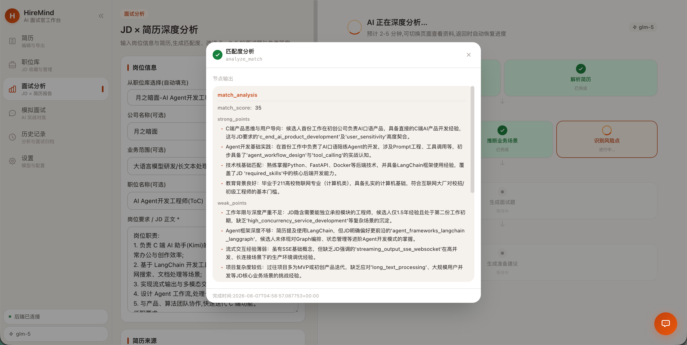
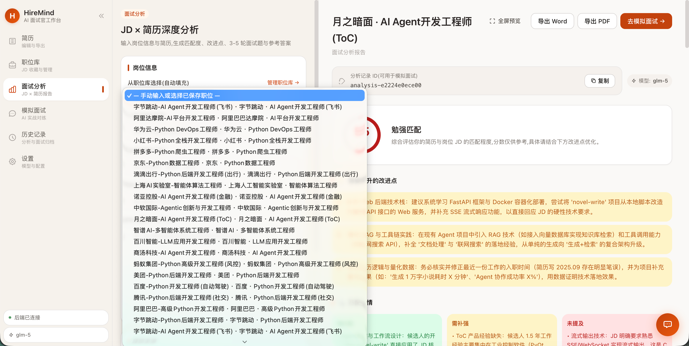
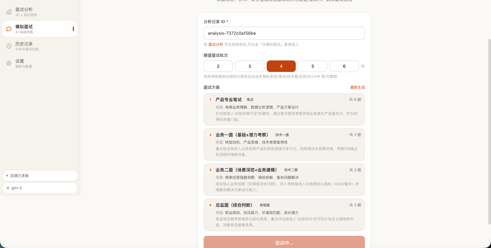
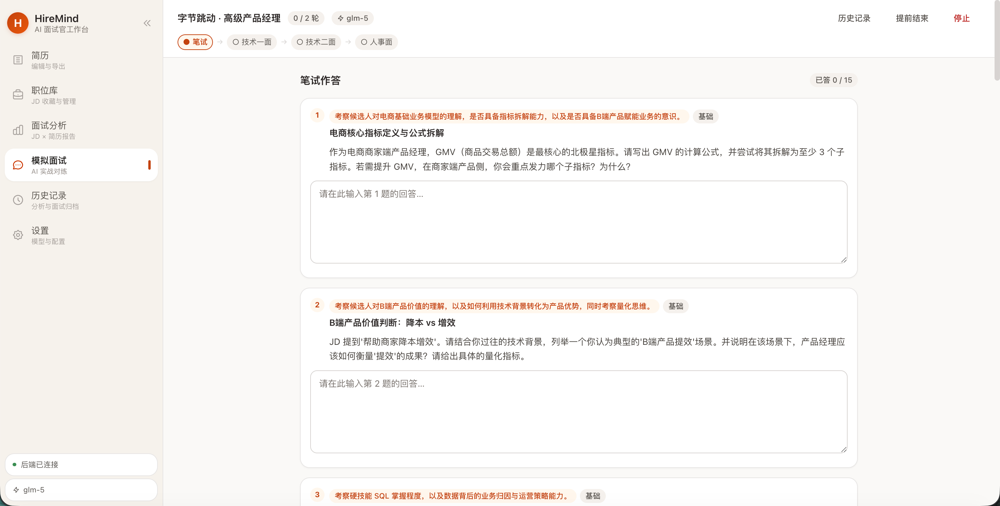
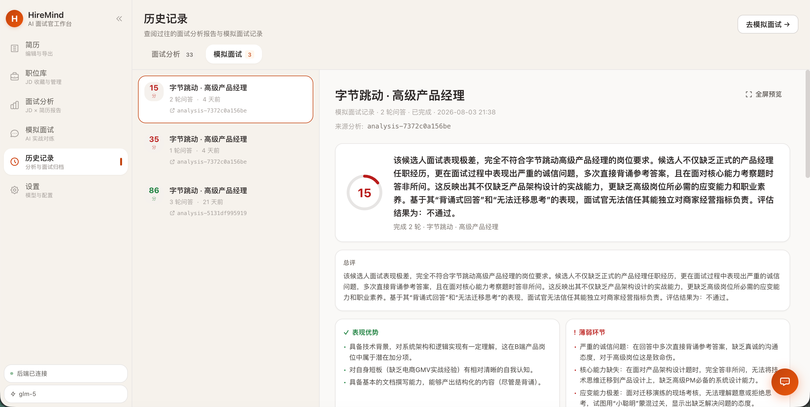
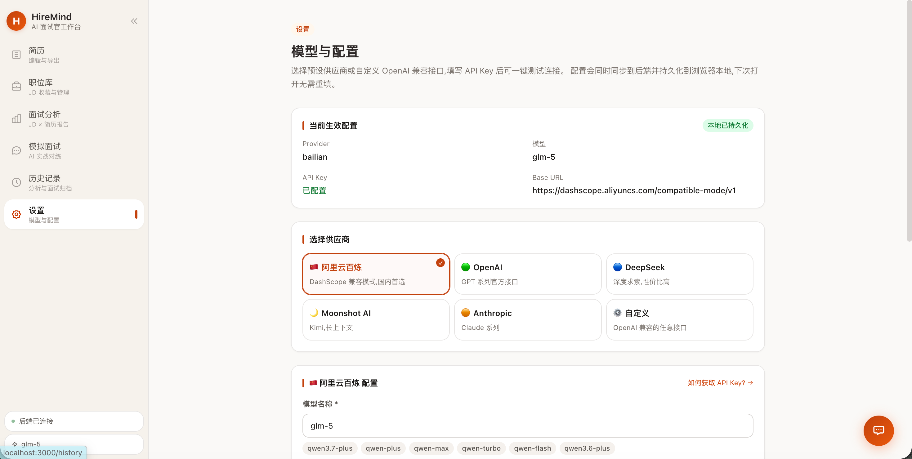

# HireMind · AI 面试官工作台

> 简历编辑、JD 深度面试分析、AI 模拟面试一站式平台。基于 LangGraph 双图架构 + Agent 控制循环 + 分层记忆系统,为求职者提供从简历打磨到面试演练的完整闭环。

---

## 一、项目简介

HireMind 是一个面向求职者的本地化 AI 面试助手。它把传统面试准备的三个核心环节——**简历优化**、**岗位匹配分析**、**模拟面试演练**——整合到一个工作台中,通过 LLM 完成深度推理与结构化输出,所有数据本地落盘,隐私可控。

### 核心价值

- **不只是聊天**:不是简单的 LLM 对话框,而是基于 LangGraph 双图架构(分析图 + 面试图)编排的多节点工作流,每一步都有结构化产出
- **可记忆、可恢复**:Agent 拥有分层记忆系统(durable 层),跨会话保留简历版本、岗位偏好、技能笔记;前端状态持久化,切换页面不丢进度
- **完整闭环**:简历 → 分析 → 模拟面试 → 报告导出,全链路打通
- **本地优先**:所有数据(简历、JD、分析报告、面试记录)落盘到 `.hiremind/` 目录,不上云
- **AI 助手全程相伴**:悬浮 Ask 助手感知当前页面上下文,可随时追问、查分析/面试节点 IO、读取简历/职位详情

---

## 二、界面演示

### 简历编辑器 `/resumes`

三栏布局:左侧简历列表、中间结构化编辑表单、右侧实时预览。支持 Classic / Modern / Minimal 三套模板,可上传 PDF/Word 解析或手动新建,一键导出 Word/PDF。



### 职位库 `/positions`

左侧搜索列表 + 右侧 JD 编辑表单,结构化录入公司名称、业务范围、职位名称、JD 正文、备注,适配匿名 JD 场景。



### 面试分析 `/analysis`

输入 JD + 简历,异步执行 LangGraph 7 节点流水线,SSE 实时推送进度。完成后输出匹配度评分、业务场景、履历风险、面试题与备考建议。

**分析进度节点**(SSE 7 阶段实时推送):



**分析结果报告**(匹配度评分环 + 场景推演 + 风险识别 + 面试题 + 备考建议):



### AI 模拟面试 `/interview`

基于分析报告启动多阶段模拟面试(笔试 → 技术一面 → 技术二面 → 人事面),LLM 智能规划阶段方案,每阶段独立评分 + 软晋级。

**智能阶段规划**(LLM 根据岗位/公司/薪资自动生成阶段方案):



**对话逐题交互**(即时评分 0-10 + 亮点 + 改进点):



### 历史记录 `/history`

双 Tab(面试分析 / 模拟面试)统一归档,左侧卡片列表 + 右侧详情,支持溯源跳转到关联简历/职位/分析。



### 模型与配置 `/settings`

6 个预设供应商(阿里云百炼 / OpenAI / DeepSeek / Moonshot / Anthropic / 自定义),一键填入默认值 + 连接测试 + 持久化到 `.hiremind/model_config.json`。



---

## 三、核心功能

### 1. 简历编辑器 `/resumes`

- **三栏布局**:左侧简历列表、中间结构化编辑表单、右侧实时预览
- **结构化字段**:基本信息(含头像上传)、教育经历、工作经历、项目经历、技能分类
- **三套模板**:Classic(经典居中)、Modern(左右分栏 + 橙色强调)、Minimal(极简时间轴)
- **文件上传解析**:支持 PDF / Word / TXT / Markdown,上传后通过 docling 提取文本 + LLM 结构化为 ResumeData
- **手动新建**:支持从空白模板开始,逐字段编辑
- **导出**:一键导出 Word(.docx)或 PDF,文件名格式 `简历_<姓名>.<ext>`,支持头像嵌入
- **URL 参数同步**:切换简历时 `?resume=<id>` 实时更新,Ask 助手能感知当前查看的简历

### 2. 职位库管理 `/positions`

- **JD 结构化录入**:公司名称、业务范围、职位名称、JD 正文、备注独立字段
- **公司名与职位名可选**:适配匿名 JD 场景
- **快速检索**:左侧列表带搜索框,按公司/职位模糊匹配
- **一键跳转分析**:选好职位后直接跳转到分析页,自动填充表单
- **URL 参数同步**:切换职位时 `?position=<id>` 实时更新,Ask 助手能感知当前查看的职位

### 3. 面试分析 `/analysis`

核心能力:输入 JD + 简历,输出一份完整的面试备考报告。

**输入**:职位信息(公司、业务范围、职位、JD 正文)+ 简历(从简历库选 / 上传解析 / 粘贴文本)

**输出报告包含**:
- **匹配度分析**:0-100 分评分环 + 强项 / 弱项 / 未提及技能 + 改进建议
- **业务场景推演**:基于公司业务范围生成 3-5 个真实业务场景,每个场景包含核心问题与切入角度
- **履历风险识别**:按高 / 中 / 低严重度标注简历中的潜在风险点,附追问建议
- **3-5 轮面试题**:每轮含问题、考察点、参考答案、出题分析
- **备考建议**:针对性学习路径与资源推荐

**流程编排**(AnalysisGraph DAG,7 个节点):
```
START ──┬──> 解析 JD ──────┬──> 匹配度分析 ────┐
        │                  ├──> 业务场景推演 ──┤
        │                  └──> 履历风险识别 ──┴──> 生成面试题 → 备考建议 → END
        └──> 解析简历 ──────┘
```

**特色机制**:
- **异步分析 + SSE 实时进度**:`POST /analysis/run` 立即返回 analysis_id,后台线程流式执行,SSE 推送 7 阶段进度
- **状态持久化**:分析中切换页面,返回后自动恢复进度(sessionStorage 30 分钟有效期)
- **停止分析**:支持中途停止,保留表单输入便于重新调整
- **结果作废**:修改任何输入(职位 / 简历 / JD)自动清空旧结果,按钮回到「开始分析」
- **历史归档**:每次分析独立 analysis 记录,落盘到 `.hiremind/analyses/`,可在历史记录页查看
- **节点 IO 透传**:每个节点的输入输出记录到 `node_io` 字段,Ask 助手可通过 `read_node_io` 工具读取

### 4. AI 模拟面试 `/interview`

基于分析报告启动一场**多阶段**模拟面试,模仿大厂真实面试流程(笔试 → 技术一面 → 技术二面 → 人事面)。

- **启动方式**:基于某次分析报告启动,或粘贴 analysis_id
- **智能阶段规划**:LLM 根据岗位/公司/薪资自动生成阶段方案(2-6 轮),每轮含阶段类型、题数、考察侧重、安排理由
- **7 种阶段类型**:笔试(written)/ 技术一面(tech_1)/ 技术二面(tech_2)/ 系统设计(system_design)/ 行为面(behavioral)/ 人事面(hr)/ 老板面(boss)
- **笔试批量模式**:笔试阶段一次性生成 5-20 题,批量提交后批量评价
- **对话逐题模式**:技术/行为/人事阶段逐题交互,每题即时评分(0-10)+ 亮点 + 改进点
- **软晋级机制**:每阶段完成后生成阶段得分(0-100)+ 评语 + 晋级提示,用户确认后推进(不淘汰)
- **最终报告**:综合评分环、分阶段成绩、总体评价、优势总结、薄弱环节、学习建议
- **中断恢复**:面试状态持久化(sessionStorage),支持切换页面后恢复;「启动中」「智能生成方案中」两种中间态也能恢复
- **放弃面试**:支持中途放弃(abandoned 状态),不生成报告
- **图状态化**:InterviewFlowGraph 按 action 路由(start/submit_answer/next_question/submit_written/advance_stage/finish/abandon/recommend_stages),每个 action 对应一个节点函数

### 5. 历史记录 `/history`

- **双 Tab**:面试分析 / 模拟面试,统一归档查看,URL 参数 `?tab=analysis|interview` 同步
- **左侧列表**:卡片式展示,含分数徽章、公司-职位、轮数、相对时间
- **右侧详情**:
  - 面试分析 Tab:完整分析报告(匹配度、场景、风险、面试题、备考建议)
  - 模拟面试 Tab:对话流回放(每一轮问答 + AI 评价)+ 分阶段成绩 + 最终报告
- **溯源跳转**:分析记录卡片可跳转到关联简历(`?resume=`)和职位(`?position=`);面试记录可跳转到关联分析(`?tab=analysis&aid=`)
- **删除记录**:每条记录卡片 hover 显示删除按钮,确认后删除(前后端同步删除 JSON 文件)

### 6. 设置 `/settings`

- **6 个预设供应商**:阿里云百炼 / OpenAI / DeepSeek / Moonshot / Anthropic / 自定义
- **一键填入默认值**:选预设后自动填入 Base URL、推荐模型、API Key 输入框
- **连接测试**:发送 ping 请求,返回延迟与回复,验证配置有效性
- **持久化**:配置写入 `.hiremind/model_config.json`,重启后端不丢失;前端 localStorage 缓存避免重复拉取
- **模型自动补全**:输入框关联 datalist,百炼预设提供 13 个模型快速选择
- **全局事件通知**:保存后派发 `hiremind:model-changed` 事件,侧边栏和 ModelBadge 实时刷新

### 7. 全局侧边栏

- **可折叠**:点击按钮在 240px / 64px 间切换,状态持久化到 localStorage
- **6 个导航项**:简历 / 职位库 / 面试分析 / 模拟面试 / 历史记录 / 设置
- **后端健康指示**:实时显示后端连接状态(绿点 / 红点 + pulse 动画)
- **当前模型显示**:实时显示后端模型配置,监听 `hiremind:model-changed` 事件刷新
- **Tooltip**:折叠态下 hover 显示导航项文字

### 8. AI 助手 Ask(悬浮球)

右下角悬浮球,全页面可用,通过 SSE 流式对话:

- **页面上下文感知**:`detectContext` 函数根据当前路由从 sessionStorage 读取业务上下文(分析 ID / 面试 ID / 简历 ID / 职位 ID),自动注入 prompt
- **8 个工具**:run_analysis / generate_more_questions / recall_memory / export_report / save_to_workspace / read_node_io / read_position / read_resume
- **分析/面试进行中保护**:`read_node_io` 检测到分析(pending)或面试(started/answering)进行中时返回提示而非空数据,避免模型空转拼凑答案
- **Markdown 渲染**:assistant 消息支持代码块、标题、粗体、列表、表格、引用等格式
- **快捷提问**:按页面动态展示快捷提问卡片

---

## 四、技术栈

| 层 | 技术 | 说明 |
|---|---|---|
| **前端** | Next.js 15 App Router + React 19 | 全客户端渲染,无 Server Components |
| **样式** | Tailwind CSS v4 + CSS 变量 | 暖色文档风(Notion-like),无 UI 库依赖 |
| **类型** | TypeScript 5.7 严格模式 | `@/*` 路径别名 |
| **后端** | FastAPI + Uvicorn | 44 个路由,异步分析 + SSE 进度推送 |
| **Agent 框架** | LangGraph + LangChain | 双图架构(AnalysisGraph + InterviewFlowGraph)+ 工具调用 + 流式执行 |
| **LLM 接入** | OpenAI 兼容 / Anthropic | 默认阿里云百炼 qwen3.7-plus |
| **文档解析** | docling + PyMuPDF + python-docx | 多级降级 |
| **导出** | python-docx + fpdf2 | Word + PDF,3 套模板独立版式,自动查找中文字体 |
| **数据校验** | Pydantic v2 | 前后端 schema 对齐 |
| **存储** | 本地文件系统(JSON / Markdown) | 无数据库依赖 |

---

## 五、快速开始

### 环境要求

- Python 3.10+(见 [pyproject.toml](pyproject.toml) `requires-python`)
- Node.js 20+(Tailwind v4 native binding 需要 glibc + Node 20+)
- 一个 LLM API Key(推荐阿里云百炼,有免费额度)

### 安装

```bash
# 后端依赖
python -m venv .venv
source .venv/bin/activate  # Windows: .venv\Scripts\activate
pip install -r requirements.txt

# 前端依赖
cd app/studio
npm install
```

### 启动

```bash
# 终端 1:后端(端口 8000)
cd /path/to/hiremind
.venv/bin/python -m uvicorn app.server.main:app --host 127.0.0.1 --port 8000 --reload

# 终端 2:前端(端口 3000)
cd app/studio
npm run dev
```

打开 http://localhost:3000,首次使用请到「设置」页配置模型与 API Key。

### Docker 部署

```bash
docker compose up -d --build
```

- 后端:`hiremind-backend:latest`,端口 8000,挂载 `.hiremind/` 持久化数据 + 源码 bind mount 热更新
- 前端:`hiremind-frontend:latest`,端口 3000,构建时内联 `NEXT_PUBLIC_API_BASE`

### 配置模型

1. 进入「设置」页
2. 选择预设供应商(推荐「阿里云百炼」)
3. 填入 API Key
4. 点击「测试连接」验证
5. 点击「保存并应用」

配置会写入 `.hiremind/model_config.json`,重启后端不丢失。优先级:model_config.json > 环境变量 > 默认值。

---

## 六、项目结构

```
hiremind/
├── app/                        # 应用层
│   ├── server/                 # FastAPI 后端
│   │   ├── config.py           # 配置(从 .hiremind/model_config.json 加载)
│   │   ├── deps.py             # 依赖注入(单例 agent / stores)
│   │   ├── main.py             # FastAPI 入口 + CORS + API 日志中间件
│   │   ├── routes.py           # 44 个 API 路由
│   │   ├── schemas.py          # Pydantic 请求/响应模型
│   │   ├── api_logger.py       # API 请求/响应日志中间件(按天落盘)
│   │   ├── llm_logger.py       # LLM 调用日志回调(按天落盘)
│   │   ├── fonts/              # 中文字体(Docker 内 PDF 导出用)
│   │   └── Dockerfile          # 后端镜像(python:3.11-slim + 中文字体)
│   └── studio/                 # Next.js 前端
│       ├── app/                # 页面路由(App Router,6 个页面 + 首页)
│       ├── components/         # 共享组件(Sidebar / ResumePreview / FloatingAskBall / MarkdownText / ModelBadge / FullscreenPreview)
│       ├── lib/                # api.ts / types.ts / utils.ts
│       ├── Dockerfile          # 前端镜像(node:20-slim 多阶段构建)
│       └── next.config.js      # rewrites 代理 + proxyTimeout 10 分钟
├── package/                    # 核心业务包
│   ├── hiremind/
│   │   ├── graph/              # LangGraph 工作流(analysis_graph / interview_graph)
│   │   ├── nodes/              # 图节点(analysis_nodes / interview_nodes,已合并为单文件)
│   │   ├── prompts/            # 17 个提示词模板
│   │   ├── services/           # 业务服务(LLM / 解析 / 导出 / 简历)
│   │   ├── models/             # Pydantic 数据模型(schemas / states)
│   │   ├── store/              # 存储层(analysis / interview / resume / position / ask)
│   │   ├── runtime.py          # Agent 运行时(HireMindAgent)
│   │   ├── context_manager.py  # ask 上下文组装与预算控制
│   │   ├── memory.py           # 分层记忆系统
│   │   ├── tools.py            # 工具集(8 个工具)
│   │   └── workspace.py        # 工作区管理
│   ├── ARCHITECTURE.md         # 核心包架构详解
│   └── PACKAGE_GUIDE.md        # 核心包使用指南
├── docs/                       # 设计文档
│   ├── ARCHITECTURE.md         # 项目整体架构
│   ├── RUNTIME_DATA.md         # .hiremind/ 运行时数据目录说明
│   └── llm-calls-overview.md   # LLM 调用全览
├── assets/                     # 界面演示截图(README 引用)
├── test/                       # 测试脚本(种子数据 / 分析 / 模拟面试)
├── .hiremind/                  # 运行时数据(gitignore)
├── docker-compose.yml          # 双服务编排
├── requirements.txt            # Python 依赖
├── pyproject.toml              # Python 项目配置
└── .gitignore
```

详细架构说明见 [docs/ARCHITECTURE.md](docs/ARCHITECTURE.md),核心包架构详解见 [package/ARCHITECTURE.md](package/ARCHITECTURE.md),运行时数据目录说明见 [docs/RUNTIME_DATA.md](docs/RUNTIME_DATA.md),LLM 调用全览见 [docs/llm-calls-overview.md](docs/llm-calls-overview.md)。

---

## 七、设计亮点

### 1. Agent 控制循环 + LangGraph 双图架构

`HireMindAgent` 是模型外围的控制循环(组 prompt → 调模型 → 解析 → 执行工具 → 写 trace),两个 LangGraph 工作流分别处理确定性的分析流程和状态机式的面试流程:

- **AnalysisGraph**(一次性 DAG):7 个节点按拓扑顺序执行,JD+简历 → 匹配度/场景/风险/题目/建议。`stream_run` 流式 yield 节点产出,支持 SSE 实时进度
- **InterviewFlowGraph**(按 action 路由的状态机):8 个 action 节点(start/submit_answer/next_question/submit_written/advance_stage/finish/abandon/recommend_stages),模拟面试多轮交互

二者通过 `tool_run_analysis` / `recommend_interview_stages` 等方法桥接到 Agent。这样既保留了 Agent 的灵活性(可多轮对话、可调用工具),又保证了分析/面试流程的确定性。

### 2. 多阶段模拟面试

模仿大厂真实流程:笔试(批量出题/批量提交)→ 技术一面 → 技术二面 → 人事面。LLM 根据岗位/公司/薪资智能规划阶段方案,每阶段独立评分 + 软晋级(不淘汰),最终报告含分阶段成绩。详见 [package/ARCHITECTURE.md](package/ARCHITECTURE.md) 第六节。

### 3. 分层记忆系统

- **Working Memory**:随 analysis 存活,记录当前 JD / 简历 / 分析结果
- **Durable Memory**:落盘到 `.hiremind/memory/`,跨 analysis 保留简历版本、岗位偏好、技能笔记、面试摘要
- **召回机制**:基于 tag 精确匹配 + 关键词重叠排序,无 embedding 依赖

### 4. 异步分析 + SSE 实时进度

LLM 分析需 2-5 分钟,采用异步任务模式:
- `POST /analysis/run` 立即返回 analysis_id,后台线程执行 LangGraph 流水线
- 每完成一个节点,进度写入 analysis 文件
- `GET /analysis/stream/{id}` SSE 端点轮询 progress 字段,实时推送给前端(7 阶段:解析JD → 解析简历 → 匹配度 → 业务场景 → 风险点 → 出题 → 准备建议)
- 前端 `streamAnalysis` API 处理 SSE 事件,支持 abort 清理
- 响应头 `X-Accel-Buffering: no` 禁用 nginx 缓冲,保证实时性

### 5. node_io 透传机制

分析图和面试图都把节点级输入输出记录到 `node_io` 字段。Ask 助手通过 `read_node_io` 工具读取,能回答关于分析/面试过程的问题(如"匹配度分析节点输出了什么""面试第二题考察什么")。工具始终从磁盘重新加载最新数据,不依赖 agent 内存快照。

### 6. Ask 助手页面上下文感知

悬浮 Ask 球根据当前路由自动从 sessionStorage 读取业务上下文(分析 ID / 面试 ID / 简历 ID / 职位 ID),注入 prompt。配合 `read_position` / `read_resume` / `read_node_io` 工具,能回答"这个岗位需要哪些技能""这次分析的匹配度如何"等基于当前页面的问题。

### 7. 暖色文档风 UI

基于 Tailwind CSS v4 + CSS 变量自研,无 UI 组件库依赖。全套设计 token(背景层 / 前景 / 边框 / 品牌橙 / 状态色 / 阴影 / 圆角)集中管理,组件类(`.card` / `.btn` / `.input` / `.badge` / `.prose-warm`)统一风格。Markdown 渲染自实现(无第三方依赖),支持代码块、表格、标题、列表等 LLM 常用格式。

---

## 八、License

私有项目,未开源。
